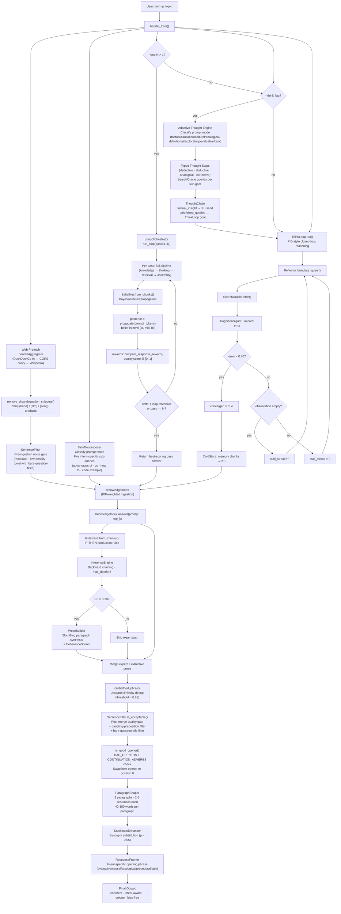

# 🛠️ LMM Architecture

LLM provides a variety of features that enable you to search and generate coherent English without any prior training or a GPU. All learning happens on the fly.

## 🔬 Key Capabilities

- 🛡️ **Ethical AI by design**: no training-data bias, no GPU requirement, no proprietary API dependencies. Full auditability, transparency, and explainability baked in.
- 🧬 **Genetic Programming**: population-based symbolic regression with template seeding (linear, quadratic, periodic) and variable-enforcement guards.
- 📐 **Symbolic Calculus**: automatic differentiation (chain rule, product rule, trig) and constant-folding simplification.
- 🌀 **Physics Suite**: Harmonic Oscillator, Lorenz Attractor, Pendulum, SIR Epidemic, N-body Gravity; All implement `Simulatable`.
- 🔢 **Field Calculus**: N-D gradient, Laplacian, divergence, and 3-D curl via central differences.
- 🔗 **Causal Reasoning**: structural causal models, `do(X=v)` interventions, and counterfactual queries.
- 🧩 **Neural Operators**: circular convolution with SGD kernel learning and Fourier spectral operators.
- 🔤 **Text ↔ Equation**: losslessly encode any text string into a symbolic equation and recover it exactly via integer residuals.
- 🔮 **Symbolic Prediction**: equation-native text continuation using sliding-window GP regression and vocabulary anchoring.
- 🔍 **Sentence Filter**: declarative pre-ingestion noise gate, discards metadata lines, disambiguation fragments, low information-density text, and sub-8-word snippets before they enter the KnowledgeIndex.
- 🔄 **Global Deduplicator**: Jaccard-similarity deduplication (threshold 0.65) eliminates near-duplicate sentences after expert + extractive prose is merged, ensuring clean, non-repetitive output.
- 🏗️ **Paragraph Shaper**: structural output formatter enforcing 2 paragraphs, 2-5 sentences per paragraph, and 40-180 words per paragraph with discourse connector injection between paragraphs.
- 🎲 **Stochastic Enhancement**: synonym-bank word replacement (`--stochastic`) delivers unique output each run while preserving mathematical sentence structure.
- 🎨 **Spectral Image Synthesis**: generate procedural PPM images from a text prompt by hashing it into Fourier wave components.
- 🧠 **Expert System**: IF-THEN production rules auto-derived from KB chunks at runtime; backward-chaining inference engine with Prospector-model certainty factors; how/why explanation facility; slot-filling `ProseBuilder` that constructs novel paragraphs, never copies verbatim.
- 🔀 **Coherence Scoring**: greedy nearest-neighbour sentence reordering by token overlap maximises topical flow across generated paragraphs.
- 💡 **Adaptive Thought Engine (ATE)**: multi-step symbolic reasoner that classifies each prompt into one of eight reasoning modes (`factual`, `causal`, `procedural`, `analogical`, `definitional`, `exploratory`, `evaluative`, `task`) and iterates through typed thought steps to build a goal-directed reasoning chain before the main pipeline runs. Activated with `--think` / `-t`.
- 🔁 **Recursive Belief Propagation Loop (`--loop N`)**: re-runs the full TRAM pipeline up to N times. After each pass a [`BeliefNet`](lmm/src/cognition/bayesian/) is built from the top KB chunks and prompt-evidence is propagated to yield a posterior belief interval. A scalar quality score (computed by `rewards::compute_response_reward`) measures answer improvement. The loop exits early when the quality delta falls below `--loop-threshold` (default `0.05`). The best-scoring pass wins. Combining with `--think` and `--deep` enables iterative retrieval refinement across passes.
- 🎯 **Context-Aware Response Framing**: the final answer is prefixed with an intent-specific phrase (e.g. "The advantages of Rust are..."). Always-on; suppressible with `--no-frame`.
- 🔍 **Task Decomposer**: fires up to `--max-tasks` intent-specific web queries to enrich the KB with mode-relevant content before reasoning.
- 💻 **Code Responder**: for `task`-mode prompts, renders a fenced code block with templates or KB-extracted snippets.

## ⚙️ Architecture

