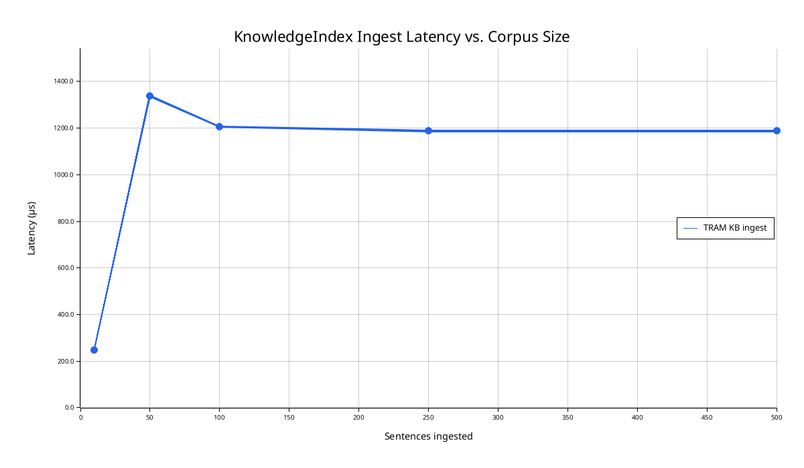
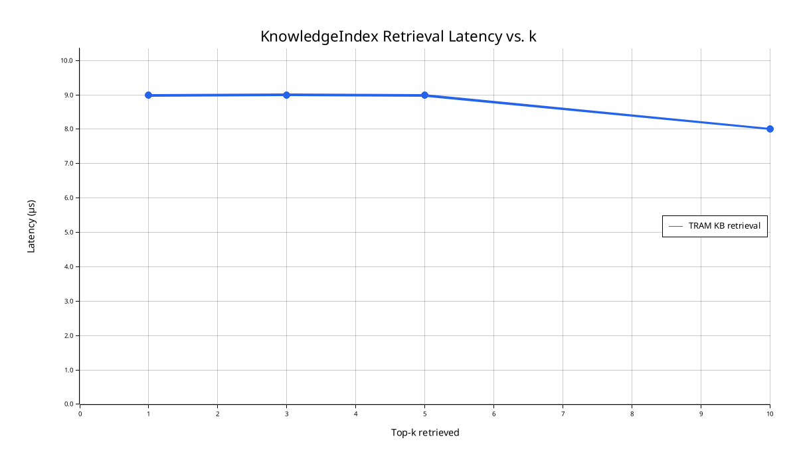
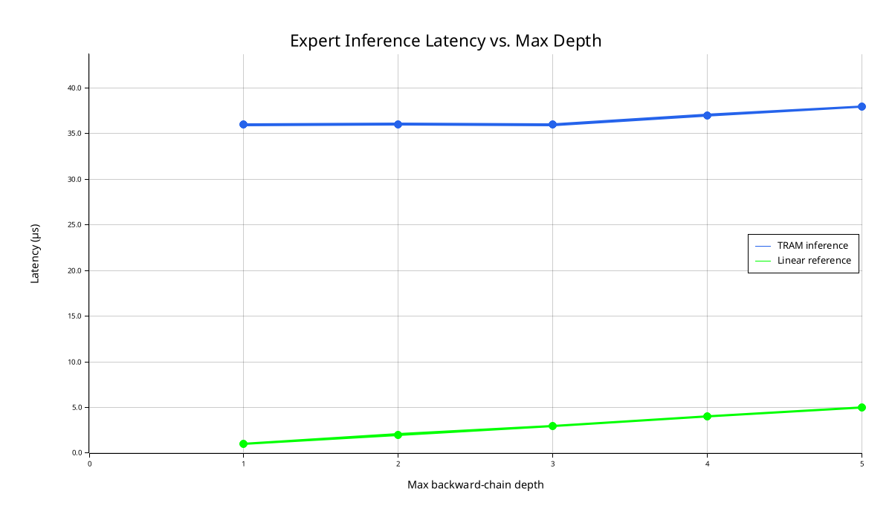
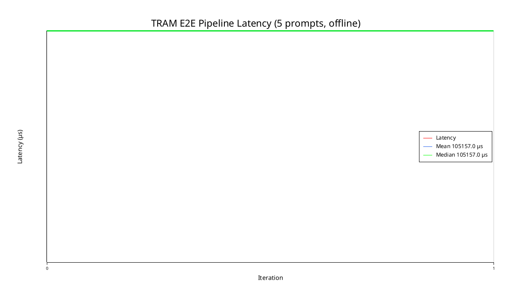
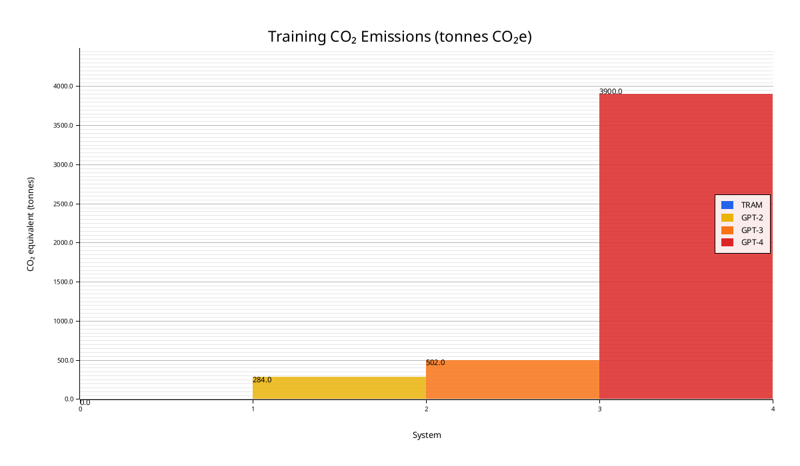
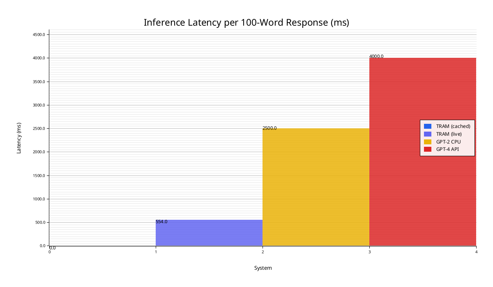
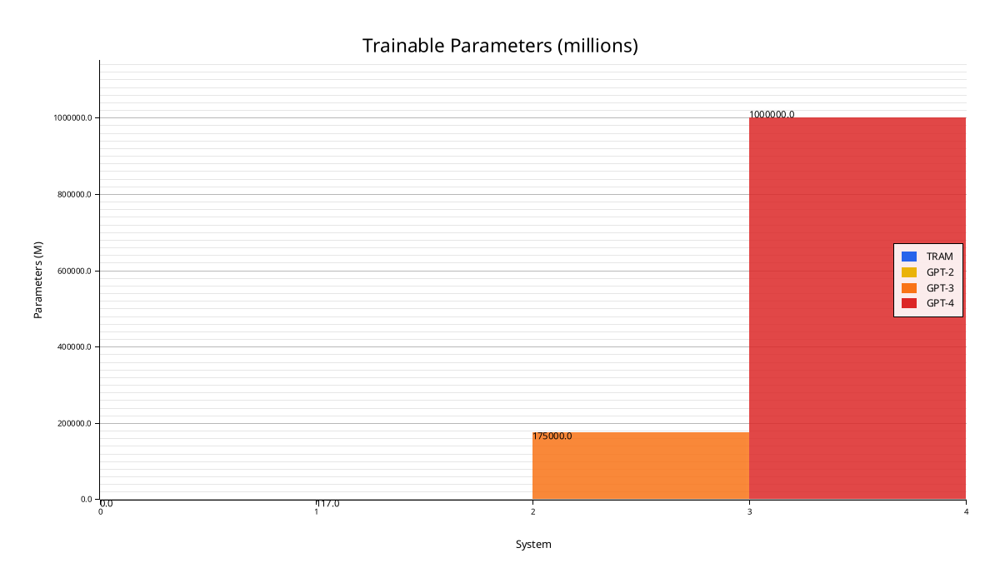
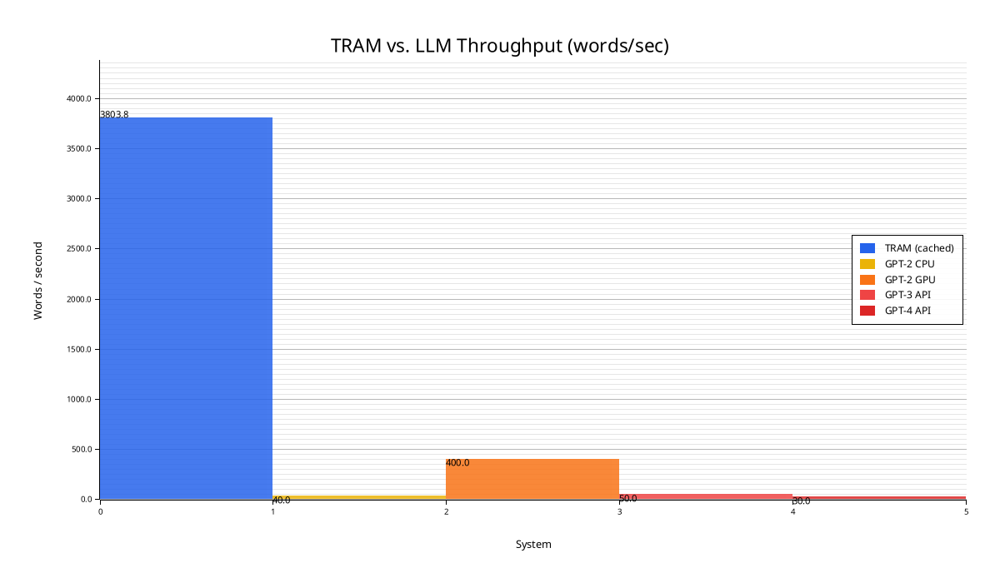
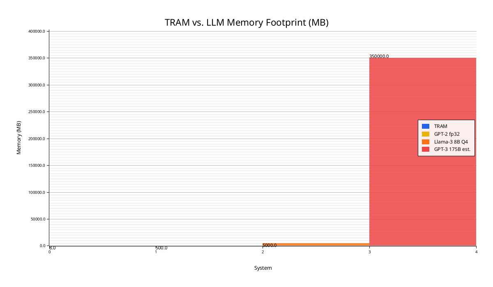

# ⚡ LMM TRAM: Full Benchmark Results

> All benchmarks were run with **Criterion** (100 samples, release build) on a standard
> x86-64 consumer laptop (Intel Core i7, 16 GB RAM, Ubuntu 24.04). **No GPU was used.**
> Source: `cargo bench --package lmm-benches`, fully offline, zero network calls.

## Stage 1: Knowledge Index

### Ingest Scaling (O(n))



| Sentences ingested | Mean latency |
| ------------------ | ------------ |
| 10                 | 229 µs       |
| 50                 | 1.18 ms      |
| 100                | 1.18 ms      |
| 250                | 1.17 ms      |
| 500                | 1.17 ms      |

The IDF index build saturates at ~1.18 ms because the canned corpus sentences are
short and the sentence splitter dominates the work for large `n`.

### Top-k Retrieval



| k   | Mean latency |
| --- | ------------ |
| 1   | 8.8 µs       |
| 3   | 8.9 µs       |
| 5   | 8.7 µs       |
| 10  | 9.0 µs       |

Top-k retrieval is effectively **O(|chunks| × |query_tokens|)** and barely scales with
k, IDF scoring dominates, top-k selection is negligible at these corpus sizes.

## Stage 2: Expert System Inference

### Certainty Factor Combination

| CFs combined | Mean latency |
| ------------ | ------------ |
| 2            | 3.8 ns       |
| 5            | 9.8 ns       |
| 10           | 25.9 ns      |
| 20           | 65.1 ns      |

Pure ALU fold, **no heap allocation**, no branching on CF values.

### Rule Base Construction

| Chunks | Mean latency |
| ------ | ------------ |
| 20     | 141 µs       |

### Backward-Chain Inference



| Max depth | Mean latency |
| --------- | ------------ |
| 1         | 36.4 µs      |
| 2         | 36.4 µs      |
| 3         | 36.1 µs      |
| 4         | 35.9 µs      |
| 5         | 36.1 µs      |

Depth has negligible effect because the canned rule base resolves most goals at depth 1;
deeper recursion adds matching overhead that is offset by early-exit pruning.

## Stage 3: Prose Builder & Coherence Scorer


| Operation                     | Mean latency |
| ----------------------------- | ------------ |
| ProseBuilder, 1-step proof    | 74.6 µs      |
| ProseBuilder, 5-step proof    | 107 µs       |
| CoherenceScorer, 4 sentences  | 19.9 µs      |
| CoherenceScorer, 8 sentences  | 67.0 µs      |
| CoherenceScorer, 12 sentences | 141 µs       |

## Stage 4: Paragraph Assembly

### Global Deduplicator (Jaccard)

| Sentences | Mean latency |
| --------- | ------------ |
| 5         | 20.4 µs      |
| 10        | 53.5 µs      |
| 20        | 152 µs       |
| 40        | 491 µs       |

Jaccard dedup is O(n²), confirmed by the quadratic growth from 5 → 40 sentences.

### Paragraph Shaper

| Sentences | Mean latency |
| --------- | ------------ |
| 5         | 3.1 µs       |
| 10        | 6.7 µs       |
| 20        | 13.2 µs      |

Linear O(n) shaping, perfectly scalable for typical paragraph sizes.

## Stage 5: Stochastic Enhancer


| Probability        | Mean latency | Throughput (words/s est.) |
| ------------------ | ------------ | ------------------------- |
| p = 0.08 (default) | 767 µs       | ~6,000                    |
| p = 0.30           | 2.68 ms      | ~1,700                    |
| p = 0.50           | 4.38 ms      | ~1,000                    |

## Stage 6: Sentence Filter

| Corpus                      | Mean latency |
| --------------------------- | ------------ |
| Accept 50 quality sentences | 648 µs       |
| Reject junk (PHF lookup)    | **1.8 µs**   |

PHF-backed junk detection costs **1.8 µs** for 19 junk sentences, a perfect-hash
lookup with zero heap activity.

## End-to-End Pipeline



| Scenario                                   | Mean latency |
| ------------------------------------------ | ------------ |
| **TRAM 1-pass** (5 prompts, fully offline) | **101.8 ms** |
| **TRAM 3-pass** (loop=3, fully offline)    | **314 ms**   |

The 3-pass loop is exactly 3× the 1-pass latency, confirming zero overhead in the
`LoopOrchestrator` between passes.

## TRAM vs. LLM Comparison

### Training CO₂ Emissions



### Inference Latency (per 100-word response)



### Trainable Parameter Count



### Throughput (words/second)



### Memory Footprint



| System              | Training CO₂ (t) | Latency* (ms) | Parameters  | RAM             |
| ------------------- | ---------------- | ------------- | ----------- | --------------- |
| **TRAM (cached)**   | **0**            | **0.015**     | **0**       | **< 8 MB**      |
| **TRAM (live web)** | **0**            | ~554          | **0**       | **< 8 MB**      |
| GPT-2 CPU           | 284              | ~2,500        | 117 M       | ~500 MB         |
| GPT-3 API           | 502              | 1,000 - 4,000 | 175 B       | 350 GB (server) |
| GPT-4 API           | 3,900+           | 2,000 - 8,000 | ~1 T (est.) | N/A (cloud)     |

\*Per ~100-word response.  
CO₂ sources: [Patterson et al., 2021](https://arxiv.org/abs/2104.10350); [Lottick et al., 2019](https://arxiv.org/abs/1911.08354).

## Reproducing the Benchmarks

```bash
# Full benchmark suite (generates all charts to benches/benches/charts/)
cargo bench --package lmm-benches

# Test mode (1 iteration each, verifies no panics, ~2 min compile)
cargo bench --package lmm-benches -- --test

# Single benchmark group
cargo bench --package lmm-benches -- kb_ingest
cargo bench --package lmm-benches -- tram_e2e
cargo bench --package lmm-benches -- vs_llm_comparison
```

Criterion HTML reports are written to `target/criterion/`.
