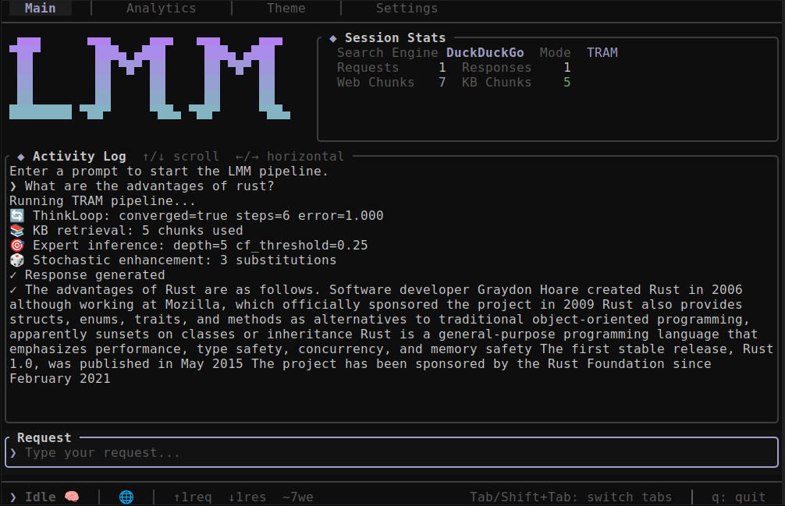
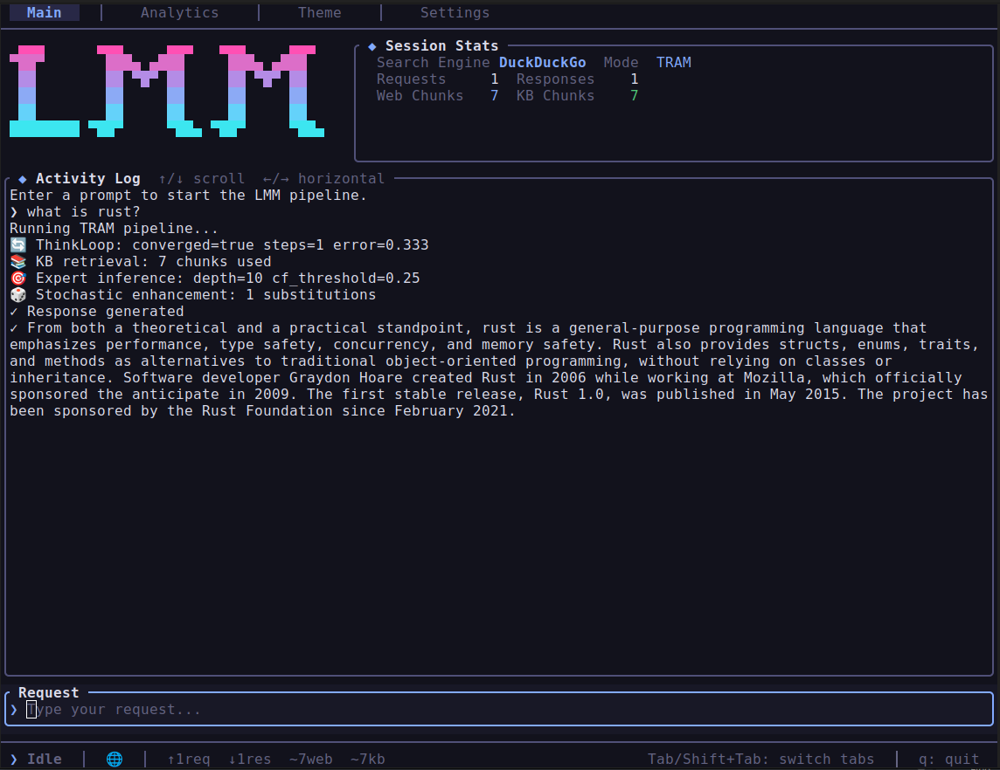
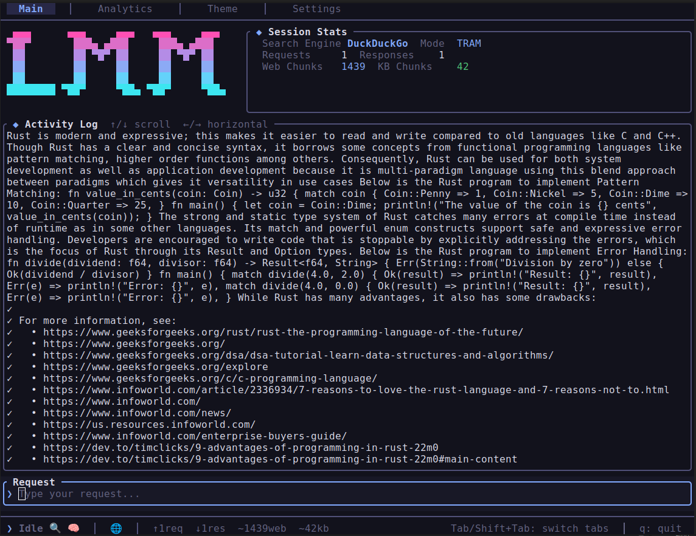

<div align="center">

# 🌟 LMM 🦀

[](https://docs.rs/lmm/)

[](https://github.com/wiseaidotdev/lmm)
[](https://arcprize.org/replay/69c86b04-c9ff-4ae2-98e8-eade2e4c2214)
[](https://crates.io/crates/lmm)
[](https://docs.rs/lmm)
[](https://crates.io/crates/lmm)
[](https://pypi.org/project/lmm-rs/)
[](https://www.npmjs.com/package/@wiseaidev/lmm)
[](https://www.rust-lang.org/)
[](https://www.rust-lang.org)
[](LICENSE)
[](https://github.com/wiseaidev)

[](https://reddit.com/submit?url=https://github.com/wiseaidotdev/lmm&title=LMM%3A%20Large%20Mathematical%20Model)
[](https://twitter.com/share?url=https://github.com/wiseaidotdev/lmm&text=LMM%3A%20Large%20Mathematical%20Model)
[](https://www.linkedin.com/shareArticle?url=https://github.com/wiseaidotdev/lmm&title=LMM%3A%20Large%20Mathematical%20Model)

> **LMM (Large Mathematical Model)** empowers you to build ethical AI systems, without GPUs, training data, or API keys. Grounded in pure mathematics and transparent symbolic reasoning, LMM gives every developer, regardless of compute budget, the ability to create AI that is auditable, explainable, and bias-free by design. No data exploitation. No environmental cost. Just mathematics.

|                                       🐧 Linux `(Recommended)`                                       |                                               🪟 Windows                                               |                                              🐳 Docker                                               |
| :--------------------------------------------------------------------------------------------------: | :----------------------------------------------------------------------------------------------------: | :--------------------------------------------------------------------------------------------------: |
|  |  |  |
|      [Download `lmm` binary](https://github.com/wiseaidotdev/lmm/releases/latest/download/lmm)       |   [Download `lmm.exe` binary](https://github.com/wiseaidotdev/lmm/releases/latest/download/lmm.exe)    |                                     `docker pull wiseaidev/lmm`                                      |
|                                  `cargo install lmm --all-features`                                  |                                   `cargo install lmm --all-features`                                   |                                    `docker run -it wiseaidev/lmm`                                    |
|                                         `lmm` ← launches TUI                                         |                                          `lmm` ← launches TUI                                          |              [Read DOCKER.md](https://github.com/wiseaidotdev/lmm/blob/main/DOCKER.md)               |

</div>

## 🎬 Demo

The following demonstrates the full TRAM (Text Reasoning and Applied Mathematics) pipeline generating coherent, non-repetitive English prose powered entirely by deterministic mathematics and transparent symbolic reasoning. The pipeline runs through six stages: web knowledge retrieval, **adaptive thought engine reasoning**, symbolic inference, global deduplication, structural shaping, and stochastic enhancement.

<video src="https://github.com/user-attachments/assets/6bf9b86f-0dcf-44a6-9bae-ea6575cf6edc"></video>

TRAM is LMM's default reasoning engine. All TRAM options are available directly at the top-level CLI command or via the explicit `tram` subcommand:

```sh
# Launch the TUI:
lmm

# Top-level direct execution (default TRAM mode):
lmm -p "rust programming" --verbose
lmm -p "machine learning" --probability=0.1 --knowledge-base ./papers --iterations 20 --verbose
lmm -p "stochastic determinism" -k ./papers -i 15 --probability=0.1 --verbose
lmm -p "rust programming" --cf-threshold 0.35 --inference-depth 4 --verbose

# Intent-aware enrichment + response framing (always on):
lmm -p "what are the advantages of rust?" --verbose
lmm -p "rust vs python" --verbose
lmm -p "write a hello world in python" --verbose

# With Adaptive Thought Engine enabled:
lmm -p "why does Rust not have a garbage collector?" --think --verbose
lmm -p "rust vs python" --think --think-steps 4 --think-threshold 0.7 --verbose
lmm -p "machine learning" --think --think-steps 6 --think-patience 2 --verbose

# Control decomposition and framing:
lmm -p "advantages of rust" --max-tasks 6 --verbose
lmm -p "rust programming" --no-frame --verbose

# Or via explicit subcommand (identical behavior):
lmm tram -p "rust programming" --verbose
lmm tram -p "machine learning" --probability=0.1 --knowledge-base ./papers --iterations 20 --verbose
lmm tram -p "stochastic determinism" -k ./papers -i 15 --verbose
lmm tram -p "rust programming" --cf 0.35 --inf-depth 4 --verbose
lmm tram -p "what is WebAssembly?" --think --verbose
lmm tram -p "write hello world in rust" --max-tasks 4 --verbose
```

## 🎛️ Modes of Operations

LMM supports 4 modes of operations: ask (regular web search), think (think & ate engine), deep search. The following demostrates the output of two of these modes:

|                                             Search                                              |                                            Think + Deep Search                                            |
| :---------------------------------------------------------------------------------------------: | :-------------------------------------------------------------------------------------------------------: |
|  |  |

For more information, see the **[Architecture](https://github.com/wiseaidotdev/lmm/blob/main/ARCH.md)** document.

## 📦 Installation

### 🦀 Rust

The `lmm` library is available on [crates.io](https://crates.io/crates/lmm). For the complete API reference, installation guide, and worked examples, see the **[Rust usage guide](https://github.com/wiseaidotdev/lmm/blob/main/RUST.md)**.

### 💻 Command-Line Interface

The `lmm` binary supports 15 subcommands spanning simulation, discovery, encoding, prediction, summarisation, and rich text generation: all powered by pure equations.

For the full option reference and usage examples, see the **[CLI documentation](https://github.com/wiseaidotdev/lmm/blob/main/CLI.md)** or run `lmm --help` after installing with `cargo install lmm --all-features`.

### 🐍 Python

The Python bindings are published to PyPI as **`lmm-rs`** and are installed with `pip install lmm-rs`. Built with [maturin](https://www.maturin.rs/), the package ships pre-compiled wheels for major CPython versions and runs a fully embedded Tokio runtime; no `asyncio` required.

For installation instructions, configuration options, and full method signatures, see the **[Python usage guide](https://github.com/wiseaidotdev/lmm/blob/main/PYTHON.md)**.

### 🟩 Node.js

The Node.js bindings are published to npm as **`@wiseaidev/lmm`** and are installed with `npm install @wiseaidev/lmm`. Built with [napi-rs](https://napi.rs/), the package ships a pre-compiled `.node` add-on with TypeScript type definitions.

For installation instructions, type definitions, and examples, see the **[Node.js usage guide](https://github.com/wiseaidotdev/lmm/blob/main/NODE.md)**.

### 🌐 WebAssembly (WASM)

LMM natively targets `wasm32-unknown-unknown`. Because `reqwest` switches to the browser `fetch` API automatically, you can deploy LMM inside Rust frontend frameworks such as **Yew**, **Dioxus**, and **Leptos** without any additional glue code.

For CORS considerations, build steps, and usage details, see the **[WASM usage guide](https://github.com/wiseaidotdev/lmm/blob/main/WASM.md)**.

## 🤖 Agent Framework

The `lmm-agent` crate extends LMM with a fully autonomous, equation-based agent layer; no LLM, no API key, no training data.

| Document                                      | Description                                                  |
| --------------------------------------------- | ------------------------------------------------------------ |
| **[AGENT.md](AGENT.md)**                      | Architecture, quick-start, types, and async API reference    |
| **[DERIVE.md](DERIVE.md)**                    | `#[derive(Auto)]` macro: generated traits and field contract |
| **[lmm-agent README](lmm-agent/README.md)**   | Crate-level API reference, builder, and example              |
| **[lmm-derive README](lmm-derive/README.md)** | Macro crate details and field rules                          |

## 📰 Publications & Research

The architecture, formal mathematics, and paradigm are fully documented in the official whitepaper:
**[Read the Whitepaper (PDF)](papers/lmm.pdf)**.

## 📂 Examples

| Example                                     | Description                                                                                                                                                                                                                                                                                                                                         |
| ------------------------------------------- | --------------------------------------------------------------------------------------------------------------------------------------------------------------------------------------------------------------------------------------------------------------------------------------------------------------------------------------------------- |
| [**chat**](examples/chat)                   | Interactive chat UI powered by all LMM generation modes: Ask (DuckDuckGo), Sentence, Paragraph, Essay, Summarize, Predict.                                                                                                                                                                                                                          |
| [**yap**](examples/yap)                     | Two LMM agents conversing non-stop using the full TRAM pipeline in WASM: web fetch → SentenceFilter → KnowledgeIndex → RuleBase → InferenceEngine → ProseBuilder → GlobalDeduplicator → ParagraphShaper. Agent Alpha queries a topic; Agent Beta derives the next sub-topic and queries back: producing varied, non-repetitive debate indefinitely. |
| [**arc-lmm-agent**](examples/arc-lmm-agent) | Autonomous ARC-AGI-3 solver using LMM's episodic reasoning. WIP: Achieves 100% success across games with $0 cost and no external AI APIs.                                                                                                                                                                                                           |

### Blog Posts

- [LLMs are Useful. LMMs will Break Reality](https://wiseai.dev/blogs/llms-are-usefull-lmms-will-break-reality): the original post that started this project.
- [Training Is An Evil Concept. LMMs Eliminates It Altogether](https://wiseai.dev/blogs/training-is-an-evil-concept-lmms-eliminates-it-altogether): ethical, architectural, and data advantages of training-free models.

## 📝 Citation

If you use LMM in your research, please cite our whitepaper:

```bibtex
@article{harmouch2026lmm,
  author  = {Mahmoud Harmouch},
  title   = {Mathematics Is All You Need: Training-Free Language Generation via
             Symbolic Regression and Stochastic Determinism},
  year    = {2026},
  url     = {https://github.com/wiseaidotdev/lmm}
}
```

## 🤝 Contributing

Contributions are welcome! Feel free to open issues or pull requests on [GitHub](https://github.com/wiseaidotdev/lmm).

## 📄 License

Licensed under the [MIT License](https://github.com/wiseaidotdev/lmm/blob/main/LICENSE).

## ⭐ Star Us

If you use or enjoy LMM, please leave us a star on [GitHub](https://github.com/wiseaidotdev/lmm)! It helps others discover the project and keeps the momentum going ☕.

[](https://star-history.com/#wiseaidotdev/lmm&Date)
