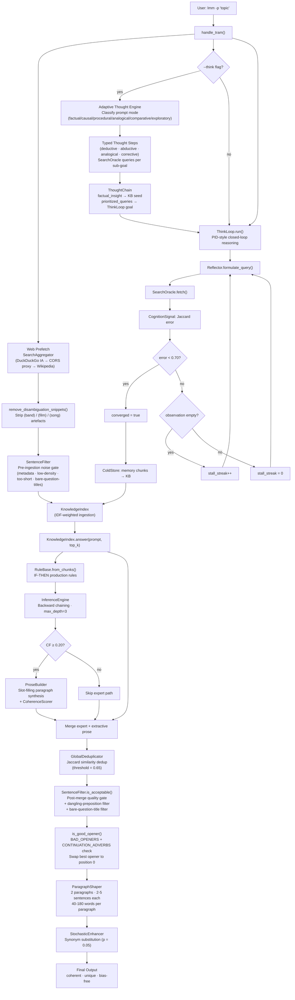

<div align="center">

# 🌟 LMM 🦀

[](https://docs.rs/lmm/)

[](https://github.com/wiseaidotdev/lmm)
[](https://arcprize.org/replay/69c86b04-c9ff-4ae2-98e8-eade2e4c2214)
[](https://crates.io/crates/lmm)
[](https://docs.rs/lmm)
[](https://crates.io/crates/lmm)
[](https://pypi.org/project/lmm-rs/)
[](https://www.npmjs.com/package/@wiseaidev/lmm)
[](https://www.rust-lang.org/)
[](https://www.rust-lang.org)
[](LICENSE)
[](https://github.com/wiseaidev)

[](https://reddit.com/submit?url=https://github.com/wiseaidotdev/lmm&title=LMM%3A%20Large%20Mathematical%20Model%20%E2%80%94%20Encode%20Reality%20as%20Equations)
[](https://twitter.com/share?url=https://github.com/wiseaidotdev/lmm&text=LMM%3A%20Large%20Mathematical%20Model%20%E2%80%94%20Encode%20Reality%20as%20Equations)
[](https://www.linkedin.com/shareArticle?url=https://github.com/wiseaidotdev/lmm&title=LMM%3A%20Large%20Mathematical%20Model)

> **LMM (Large Mathematical Model)** empowers you to build ethical AI systems, without GPUs, training data, or API keys. Grounded in pure mathematics and transparent symbolic reasoning, LMM gives every developer, regardless of compute budget, the ability to create AI that is auditable, explainable, and bias-free by design. No data exploitation. No environmental cost. Just mathematics.

|                                 🐧 Linux `(Recommended)`                                  |                                            🪟 Windows                                             |                                  🐳 Docker                                   |
| :---------------------------------------------------------------------------------------: | :-----------------------------------------------------------------------------------------------: | :--------------------------------------------------------------------------: |
|               |                     |  |
| [Download `lmm` binary](https://github.com/wiseaidotdev/lmm/releases/latest/download/lmm) | [Download `lmm.exe` binary](https://github.com/wiseaidotdev/lmm/releases/latest/download/lmm.exe) |                         `docker pull wiseaidev/lmm`                          |
|                            `cargo install lmm --all-features`                             |                                `cargo install lmm --all-features`                                 |                        `docker run -it wiseaidev/lmm`                        |
|                                   `lmm` ← launches CLI                                    |                                       `lmm` ← launches CLI                                        |  [Read DOCKER.md](https://github.com/wiseaidotdev/lmm/blob/main/DOCKER.md)   |

</div>

## 🎬 Demo

The following demonstrates the full TRAM (Text Reasoning and Applied Mathematics) pipeline generating coherent, non-repetitive English prose powered entirely by deterministic mathematics and transparent symbolic reasoning. The pipeline runs through six stages: web knowledge retrieval, **adaptive thought engine reasoning**, symbolic inference, global deduplication, structural shaping, and stochastic enhancement.

<video src="https://github.com/user-attachments/assets/0d4ff87e-bf09-4a2e-bcf4-00a4e9754885"></video>

### 🔬 Key Capabilities

- 🛡️ **Ethical AI by design**: no training-data bias, no GPU requirement, no proprietary API dependencies. Full auditability, transparency, and explainability baked in.
- 🧬 **Genetic Programming**: population-based symbolic regression with template seeding (linear, quadratic, periodic) and variable-enforcement guards.
- 📐 **Symbolic Calculus**: automatic differentiation (chain rule, product rule, trig) and constant-folding simplification.
- 🌀 **Physics Suite**: Harmonic Oscillator, Lorenz Attractor, Pendulum, SIR Epidemic, N-body Gravity; All implement `Simulatable`.
- 🔢 **Field Calculus**: N-D gradient, Laplacian, divergence, and 3-D curl via central differences.
- 🔗 **Causal Reasoning**: structural causal models, `do(X=v)` interventions, and counterfactual queries.
- 🧩 **Neural Operators**: circular convolution with SGD kernel learning and Fourier spectral operators.
- 🔤 **Text ↔ Equation**: losslessly encode any text string into a symbolic equation and recover it exactly via integer residuals.
- 🔮 **Symbolic Prediction**: equation-native text continuation using sliding-window GP regression and vocabulary anchoring.
- 🔍 **Sentence Filter**: declarative pre-ingestion noise gate, discards metadata lines, disambiguation fragments, low information-density text, and sub-8-word snippets before they enter the KnowledgeIndex.
- 🔄 **Global Deduplicator**: Jaccard-similarity deduplication (threshold 0.65) eliminates near-duplicate sentences after expert + extractive prose is merged, ensuring clean, non-repetitive output.
- 🏗️ **Paragraph Shaper**: structural output formatter enforcing 2 paragraphs, 2-5 sentences per paragraph, and 40-180 words per paragraph with discourse connector injection between paragraphs.
- 🎲 **Stochastic Enhancement**: synonym-bank word replacement (`--stochastic`) delivers unique output each run while preserving mathematical sentence structure.
- 🎨 **Spectral Image Synthesis**: generate procedural PPM images from a text prompt by hashing it into Fourier wave components.
- 🧠 **Expert System**: IF-THEN production rules auto-derived from KB chunks at runtime; backward-chaining inference engine with Prospector-model certainty factors; how/why explanation facility; slot-filling `ProseBuilder` that constructs novel paragraphs, never copies verbatim.
- 🔀 **Coherence Scoring**: greedy nearest-neighbour sentence reordering by token overlap maximises topical flow across generated paragraphs.
- 💡 **Adaptive Thought Engine (ATE)**: multi-step symbolic reasoner that classifies each prompt into a reasoning mode (factual, causal, procedural, analogical, comparative, exploratory) and iterates through typed thought steps (deductive, abductive, analogical, corrective) to build a goal-directed reasoning chain before the main pipeline runs. Activated with `--think` / `-t`. Fully controllable via `--think-steps`, `--think-threshold`, and `--think-patience`.

## 🧮 TRAM: Text Reasoning and Applied Mathematics

TRAM is LMM's default reasoning engine. All TRAM options are available directly at the top-level CLI command or via the explicit `tram` subcommand:

```sh
# Top-level direct execution (default TRAM mode):
lmm -p "rust programming" --verbose
lmm -p "machine learning" --probability=0.1 --knowledge-base ./papers --iterations 20 --verbose
lmm -p "stochastic determinism" -k ./papers -i 15 --probability=0.1 --verbose
lmm -p "rust programming" --cf-threshold 0.35 --inference-depth 4 --verbose

# With Adaptive Thought Engine enabled:
lmm -p "why does Rust not have a garbage collector?" --think --verbose
lmm -p "rust vs python" --think --think-steps 4 --think-threshold 0.7 --verbose
lmm -p "machine learning" --think -t --think-steps 6 --think-patience 2 --verbose

# Or via explicit subcommand (identical behavior):
lmm tram -p "rust programming" --verbose
lmm tram -p "machine learning" --probability=0.1 --knowledge-base ./papers --iterations 20 --verbose
lmm tram -p "stochastic determinism" -k ./papers -i 15 --verbose
lmm tram -p "rust programming" --cf 0.35 --inf-depth 4 --verbose
lmm tram -p "what is WebAssembly?" --think --verbose
```

### ⚙️ Architecture



## 📦 Installation

The `lmm` crate ships the following Cargo features:

| Feature       | Description                                          |
| ------------- | ---------------------------------------------------- |
| `rust-binary` | Enables the standalone `lmm` terminal CLI executable |
| `cli`         | Core CLI scaffolding (subsets of `rust-binary`)      |
| `net`         | Internet-aware `ask` command via DuckDuckGo search   |
| `python`      | Python extension module via `pyo3` / maturin         |
| `node`        | Node.js native add-on via `napi-derive`              |

## 🦀 Rust

The `lmm` library is available on [crates.io](https://crates.io/crates/lmm). For the complete API reference, installation guide, and worked examples, see the **[Rust usage guide](https://github.com/wiseaidotdev/lmm/blob/main/RUST.md)**.

## 💻 Command-Line Interface

The `lmm` binary supports 15 subcommands spanning simulation, discovery, encoding, prediction, summarisation, and rich text generation: all powered by pure equations.

For the full option reference and usage examples, see the **[CLI documentation](https://github.com/wiseaidotdev/lmm/blob/main/CLI.md)** or run `lmm --help` after installing with `cargo install lmm --all-features`.

## 🐍 Python

The Python bindings are published to PyPI as **`lmm-rs`** and are installed with `pip install lmm-rs`. Built with [maturin](https://www.maturin.rs/), the package ships pre-compiled wheels for major CPython versions and runs a fully embedded Tokio runtime; no `asyncio` required.

For installation instructions, configuration options, and full method signatures, see the **[Python usage guide](https://github.com/wiseaidotdev/lmm/blob/main/PYTHON.md)**.

## 🟩 Node.js

The Node.js bindings are published to npm as **`@wiseaidev/lmm`** and are installed with `npm install @wiseaidev/lmm`. Built with [napi-rs](https://napi.rs/), the package ships a pre-compiled `.node` add-on with TypeScript type definitions.

For installation instructions, type definitions, and examples, see the **[Node.js usage guide](https://github.com/wiseaidotdev/lmm/blob/main/NODE.md)**.

## 🌐 WebAssembly (WASM)

LMM natively targets `wasm32-unknown-unknown`. Because `reqwest` switches to the browser `fetch` API automatically, you can deploy LMM inside Rust frontend frameworks such as **Yew**, **Dioxus**, and **Leptos** without any additional glue code.

For CORS considerations, build steps, and usage details, see the **[WASM usage guide](https://github.com/wiseaidotdev/lmm/blob/main/WASM.md)**.

## 🤖 Agent Framework

The `lmm-agent` crate extends LMM with a fully autonomous, equation-based agent layer; no LLM, no API key, no training data.

| Document                                      | Description                                                  |
| --------------------------------------------- | ------------------------------------------------------------ |
| **[AGENT.md](AGENT.md)**                      | Architecture, quick-start, types, and async API reference    |
| **[DERIVE.md](DERIVE.md)**                    | `#[derive(Auto)]` macro: generated traits and field contract |
| **[lmm-agent README](lmm-agent/README.md)**   | Crate-level API reference, builder, and example              |
| **[lmm-derive README](lmm-derive/README.md)** | Macro crate details and field rules                          |

## 📰 Publications & Research

The architecture, formal mathematics, and paradigm are fully documented in the official whitepaper:
**[Read the Whitepaper (PDF)](papers/lmm.pdf)**.

## 📂 Examples

| Example                                     | Description                                                                                                                                                                                                                                                                                                                                         |
| ------------------------------------------- | --------------------------------------------------------------------------------------------------------------------------------------------------------------------------------------------------------------------------------------------------------------------------------------------------------------------------------------------------- |
| [**chat**](examples/chat)                   | Interactive chat UI powered by all LMM generation modes: Ask (DuckDuckGo), Sentence, Paragraph, Essay, Summarize, Predict.                                                                                                                                                                                                                          |
| [**yap**](examples/yap)                     | Two LMM agents conversing non-stop using the full TRAM pipeline in WASM: web fetch → SentenceFilter → KnowledgeIndex → RuleBase → InferenceEngine → ProseBuilder → GlobalDeduplicator → ParagraphShaper. Agent Alpha queries a topic; Agent Beta derives the next sub-topic and queries back: producing varied, non-repetitive debate indefinitely. |
| [**arc-lmm-agent**](examples/arc-lmm-agent) | Autonomous ARC-AGI-3 solver using LMM's episodic reasoning. WIP: Achieves 100% success across games with $0 cost and no external AI APIs.                                                                                                                                                                                                           |

### Blog Posts

- [LLMs are Useful. LMMs will Break Reality](https://wiseai.dev/blogs/llms-are-usefull-lmms-will-break-reality): the original post that started this project.
- [Training Is An Evil Concept. LMMs Eliminates It Altogether](https://wiseai.dev/blogs/training-is-an-evil-concept-lmms-eliminates-it-altogether): ethical, architectural, and data advantages of training-free models.

## 📝 Citation

If you use LMM in your research, please cite our whitepaper:

```bibtex
@article{harmouch2026lmm,
  author  = {Mahmoud Harmouch},
  title   = {Mathematics Is All You Need: Training-Free Language Generation via
             Symbolic Regression and Stochastic Determinism},
  year    = {2026},
  url     = {https://github.com/wiseaidotdev/lmm}
}
```

## 🤝 Contributing

Contributions are welcome! Feel free to open issues or pull requests on [GitHub](https://github.com/wiseaidotdev/lmm).

## 📄 License

Licensed under the [MIT License](LICENSE).

## ⭐ Star Us

If you use or enjoy LMM, please leave us a star on [GitHub](https://github.com/wiseaidotdev/lmm)! It helps others discover the project and keeps the momentum going ☕.

[](https://star-history.com/#wiseaidotdev/lmm&Date)
